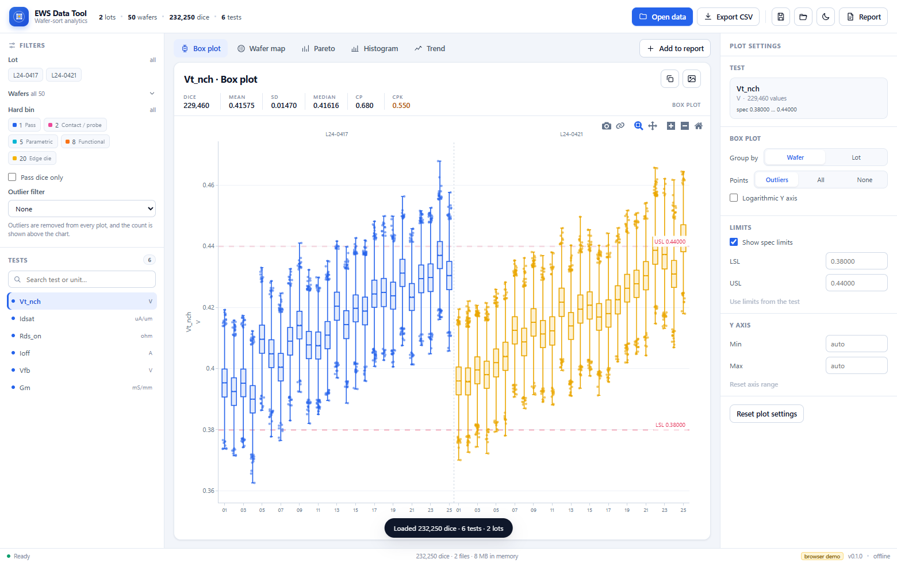
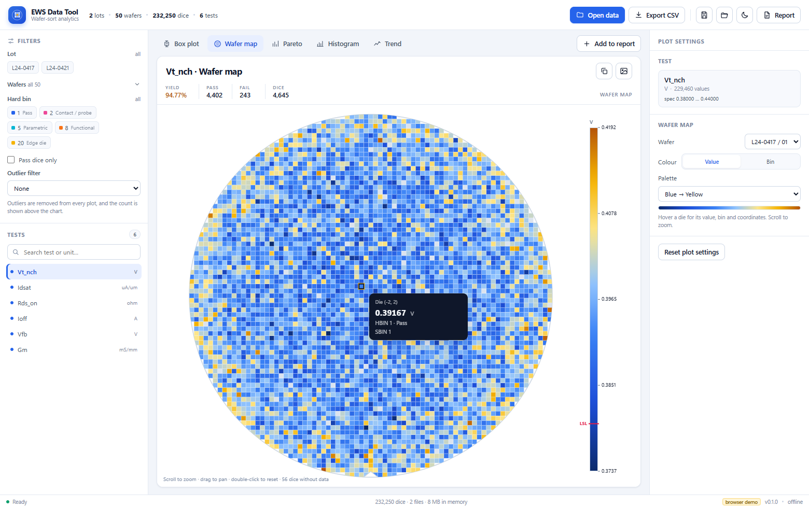
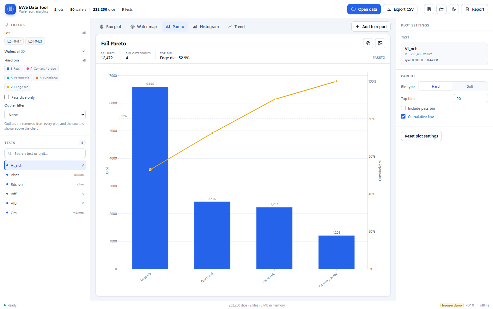
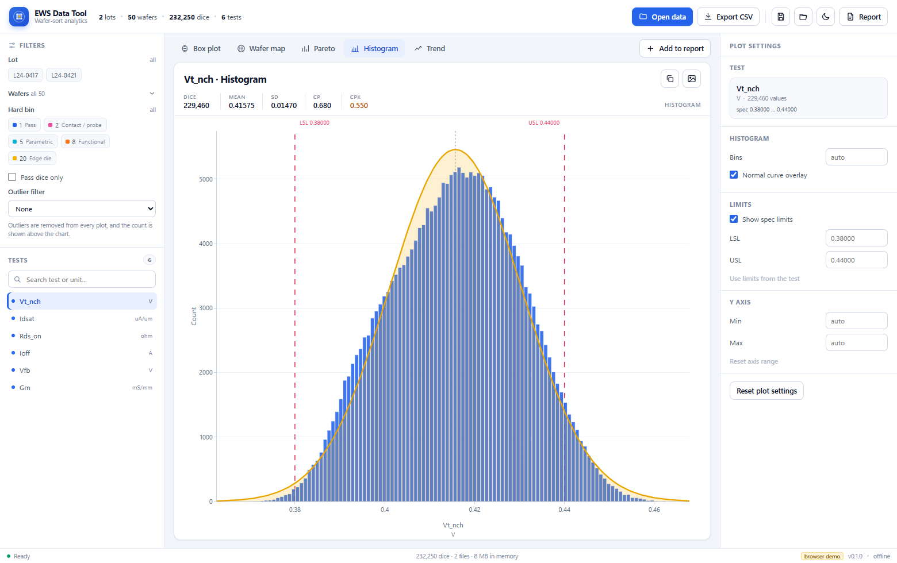
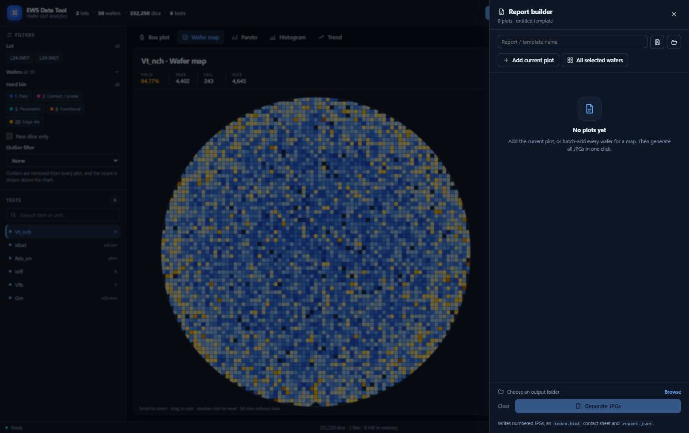

# EWS Data Tool

A fast, offline Windows desktop app for wafer-sort (EWS) data. Open STDF or CSV
files (including Unix-compressed `.Z`), explore box plots, value/bin wafer maps,
a multi-wafer Bin map, Pareto charts, histograms, trends and scatter plots,
split any grouped view into report clusters, then generate a complete JPG report
from a reusable template.

Built with **Tauri 2 + Rust** for parsing/aggregation and **React + Plotly** for
the charts. The wafer map is a custom canvas renderer for precise die grids,
hover values, zoom/pan and high-resolution JPG export.



## Highlights

- **Fast, local and compact** — Rust parses STDF/CSV in the background; the
  installer is about 3.5 MB and nothing leaves the machine.
- **Seven plot views** - box plots (by wafer or lot), value/bin wafer maps, a
  Bin map overview of every wafer, global or lot/wafer/split Pareto charts,
  histograms, trends and X/Y scatter plots with optional continuous or
  categorical Z colour.
- **Presentation-ready** - slide-sized fonts, thicker lines and stronger
  markers; JPG, clipboard and report exports use a light background at
  2400x1500 with the chart title baked in.
- **Split plots** - turn a grouped box, scatter, map or Bin map into one plot
  per block/category/wafer/lot. Reports save them as a named cluster with the
  split in every title and filename.
- **Custom wafer labels** - stage several labels for different wafer groups in
  one dialog, then save once. Use the column to colour box plots, split maps or
  drive scatter categories. A text `Split` column added in Excel is imported
  automatically. Labels travel with templates and `report.json`.
- **Real EWS features** - LSL/USL and control limits, CP/CPK, IQR and k-sigma
  outlier filters, pass-only / bin / lot / wafer filters, hover provenance, STDF WCR die geometry and a continuous wafer notch.
  Die X/Y, bin and value provenance, log axes and per-plot Y limits are included.
- **Templates that build reports** — save every report plot, its filters,
  theme and custom label columns to one JSON file; load it on new data and
  generate all JPGs in one click.
- **STDF → CSV** — use the same import as a converter; `.Z` files are
  decompressed transparently.
- **Blue + yellow design** with light and dark themes.

| Wafer map | Pareto |
| --- | --- |
|  |  |

| Histogram | Report builder |
| --- | --- |
|  |  |

## Getting started

### Desktop app (recommended)

Download the latest Windows installer from the
[Releases](https://github.com/aristofanee/ews-data-tool/releases/latest) page,
or build it locally:

```powershell
npm install
npm run tauri dev      # development window
npm run tauri build    # release build + NSIS installer
```

Build output:

- `src-tauri\target\release\ews-data-tool.exe`
- `src-tauri\target\release\bundle\nsis\EWS Data Tool_0.3.3_x64-setup.exe`

### Browser preview

```powershell
npm run dev
```

Open <http://127.0.0.1:1420> and click **Load demo data**. The browser build uses
a synthetic dataset so the UI can be explored without Tauri; file dialogs, batch
report export and real file parsing require the desktop app.

## Using the app

1. **Open data** (`Ctrl+O`) and pick one or more STDF/CSV files, including
   compressed `.Z` files. Files are merged into one dataset; duplicate dice are
   kept as separate rows.
2. Use the **Filters** panel to narrow by lot, wafer, hard bin, pass dice or a
   statistical outlier rule. The test list selects the parameter.
3. Pick a plot tab (`Ctrl+1` to `Ctrl+7`). The **Plot settings** panel on the
   right controls grouping, spec/control limits, Y range, map palette and more.
   Scatter plots choose X/Y tests plus an optional Z test or category column
   (lot, OCR wafer ID, bin, or a custom label column).
4. In **Custom labels**, add a column (for example `Split`), select wafers and
   assign a label. Use it as the box **Colour / block** or scatter **Z
   category**; empty labels clear the assignment.
5. **Add to report** collects the current plot. Use **All selected wafers** (on a
   map) or **All tests** (on box/hist/trend) to batch-add plots.
6. In **Report builder**, choose an output folder and **Generate JPGs**. The app
   writes numbered JPGs, an `index.html` contact sheet and `report.json`.
7. **Save template** (`Ctrl+S`) stores the report, settings and custom labels;
   **Load template** applies them to new data. Templates include the theme.
8. **Save as JPG** exports the current chart at 2400x1500; **Copy image** puts it
   on the clipboard. Both use a light background and include the title.
   **Export CSV** (`Ctrl+E`) writes the filtered dataset, including custom label
   columns.

Map interaction: scroll to zoom, drag to pan, double-click to reset. Plotly
charts support hover, box zoom and pan from the mode bar.

## Data formats

### STDF

- STDF **V4** (`.stdf`, `.std`), little- or big-endian.
- Unix `compress` **`.Z`** streams are detected by magic bytes and decompressed
  before parsing; gzip/zip are not used.
- Records used: FAR, MIR, WIR, WCR, PIR, PTR, MPR, PRR, HBR, SBR, TSR, WRR, MRR.
- Test names, units, limits and scaling are read from the STDF records. The WIR
  wafer ID (OCR) is available as a scatter/category grouping key.
- Tolerant of older writers: unpadded `Cn` strings, omitted trailing
  `LO_SPEC`/`HI_SPEC` fields and `0x00` bin pass flags are handled.
- ATDF (ASCII STDF) is **not supported yet**; non-CSV files are sent to the
  STDF V4 parser.

### CSV / TXT

The importer detects the delimiter (`,` `;` tab `|`), UTF-8/UTF-16 encodings,
and two layouts. It skips preamble rows, finds the real header, and consumes
metadata rows such as `Tests#`, `Unit`, `LowL` and `HighL` before the data.

**Wide** — one row per die, one column per test:

```csv
Lot,Wafer,X,Y,HBIN,SBIN,Vt_nch [V],Idsat [uA/um],Rds_on [ohm],Split
L24-0417,01,0,-22,1,1,0.41515,521.89,12.741,Split A
L24-0417,01,-6,-21,1,1,0.41439,488.87,13.352,Split A
L24-0417,02,0,-22,1,1,0.41602,519.11,12.803,Split B
```

- Key columns are recognised by name: `Lot`, `Wafer`, `X`, `Y`, `HBIN`, `SBIN`.
- Every other numeric column becomes a test. Units are read from a trailing
  `[unit]` or `(unit)` in the header.
- Text columns such as `Split` become wafer-level custom columns and can be
  selected as a box **Colour / block** or scatter **Z category**. A column is
  skipped if one wafer has conflicting labels.
- Decimal commas are accepted when the delimiter is not a comma.

**Long** — one row per measurement:

```csv
Lot,Wafer,X,Y,HBIN,Test,Value,Split
L24-0417,01,-6,-21,1,Vt_nch,0.41439,Split A
L24-0417,01,-6,-21,1,Idsat,488.87,Split A
```

Column mapping is automatic for common names. If Lot, Wafer/OCR, X or Y cannot
be detected, a manual picker maps those columns before import. The CSV exporter
writes header + `Tests#`/`Unit`/`LowL`/`HighL` + data, so exported files round-trip
through this importer; very small or large values use scientific notation.

### Synthetic sample data

```powershell
node tools/make-sample-data.mjs          # 2 lots x 10 wafers, ~30k dice
node tools/make-sample-data.mjs --full   # 2 lots x 25 wafers, ~232k dice
```

This writes `sample-data/sample-wide.csv` (units in headers) and
`sample-data/sample-long.csv`. Values include lot/wafer drift, radial and edge
signatures and realistic bin failures.

## Performance

- STDF is memory-mapped and parsed record-by-record; CSV is streamed.
- Values are stored as one `f32` column per test, so a lot with 25 wafers ×
  4,500 dice × 500 tests is about 225 MB of measurement data.
- Aggregation (box stats, histograms, Pareto counts, trend means) runs in Rust
  on a blocking worker; only summaries and the selected map/outlier points cross
  into JavaScript.
- Box plots cap plotted outlier points to keep the UI responsive; the box
  statistics always use every value.
- Wafer maps batch dice into one path per colour and use a plain circular clip,
  cutting the flat/notch back out afterwards. This keeps hover, Bin map and
  split-map redraws responsive on large STDF files with physical WCR geometry.

## Tests

```powershell
$env:STDF_DEMO="$env:TEMP\pystdf\pystdf-main\data\demofile.stdf"
$env:STDF_DEMO_Z="$env:TEMP\pystdf\pystdf-main\data\demofile.stdf.Z"
cargo test --manifest-path src-tauri\Cargo.toml --lib
```

The suite covers the reference STDF file (1,619 dice, 74 tests), the compressed
`.Z` fixture, wide/long CSV import, semicolon + decimal-comma CSV, text `Split`
columns, the full query pipeline (box/map/Pareto/histogram/trend/scatter), custom
label columns and box block colours. There are 19 Rust tests.

Visual and desktop smoke tests (browser demo, requires `npm run dev`):

```powershell
node tools\shoot.mjs       # screenshots of every plot in light/dark mode
node tools\flow.mjs        # JPG save, report builder, template save, bin map
node tools\desktop.mjs     # real app via WebView2 CDP: STDF import, clipboard,
                           # every chart tab and a 4-plot batch report on disk
node tools\desktop-v2.mjs  # v0.3: .Z import, custom labels, scatter modes,
                           # box blocks, dark modal, clipboard, report and CSV
                           # re-import with an Excel-added Split column
node tools\desktop-v3.mjs  # v0.3: Bin map, split map report cluster, CSV
                           # manual mapping, tiny-number export, limit conflicts
```

The desktop tests expect the release build and the Galaxy Semiconductor STDF
samples under `%TEMP%\pystdf\pystdf-main\data` (see the test command above).

## Current limitations / next steps

- ATDF is not implemented.
- CSV columns/units are auto-detected; a manual picker handles missing Lot/Wafer/X/Y,
  but there is no separate unit editor yet.
- Filters cover lot, wafer, bin, pass dice and statistical outliers. Date, site,
  die X/Y range and edge exclusion are not exposed yet (`edgeExclusion` exists in
  the plot spec but is unused).
- Group/colour is by lot, wafer or a custom label column; site-level grouping is
  not parsed yet.
- Custom labels are session data, not written back to the STDF file. They are
  included in templates, CSV exports and `report.json`. Text metadata columns
  from CSV are imported as wafer-level labels; per-die metadata is not supported.
- Templates store test/wafer indices, so they are directly reusable across lots
  from the same test program. A dataset with a different test order may need
  plot adjustments after loading a template.
- STDF/CSV files can disagree on a test's USL/LSL. The first non-empty limit is
  kept and the Limits panel warns when a conflict was detected; per-lot limit
  sets are not modelled yet, so set LSL/USL explicitly for mixed-limit lots.
- The browser demo cannot write batch reports or read real files.

## Project layout

```
src/                 React UI, Plotly figures, canvas wafer map, report writer
src-tauri/src/       Rust STDF/CSV import, columnar dataset, stats, queries
tools/               sample-data generator, Playwright visual/functional tests
docs/                filled requirements template
shots/               screenshots from the visual test run
sample-data/         generated CSV examples
```
